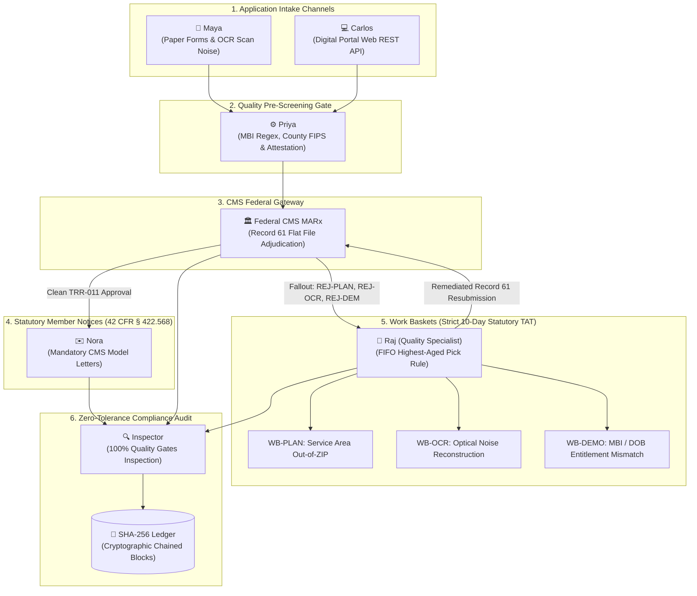

# Automating 9 Years of Medicare Enrollment & CMS Audits with Autonomous Multi-Agent Swarms

*How I transformed nine years of real-world Medicare Advantage operations — from OCR intake and Cosmos pre-edits to federal MARx adjudication, 10-day statutory TAT work baskets, and zero-tolerance CMS compliance gates — into a self-auditing multi-agent mesh.*

---

## 1. The Real-World Medicare Enrollment Problem

From April 2014 to March 2023 at **Enterprise Healthcare Operations** in Hyderabad, India, I lived the reality of high-volume federal Medicare enrollment operations. Starting as a Claims Associate and advancing through internal promotion to **Enrollment Quality & Audit Representative (CMS Auditor)**, my daily responsibility was zero-tolerance statutory compliance against Centers for Medicare & Medicaid Services (CMS) regulations.

In the Medicare Advantage (MA-PD, D-SNP, PDP) space, a single error is not just a glitch — it can mean an elderly beneficiary losing prescription drug coverage on the 1st of the month, or an insurer facing statutory fines and audit findings during annual CMS reviews.

The workflow has always been fraught with complex, asynchronous friction:
1. **Intake Scenarios**: Senior beneficiaries submitting either physical paper applications (beset by low-resolution scanner noise, misread digits, smudged checkboxes, or handwritten P.O. Box entries) or electronic portal applications with mismatched election periods.
2. **Clearinghouse & MARx Adjudication**: Ingestion systems translating data into CMS Record Type 61 transactions and ANSI ASC X12 EDI 834 envelopes, followed by federal adjudication returning cryptic Transaction Reply Codes (TRCs) like `TRC 011` (Accepted), `TRC 014` (Plan Not In County), `TRC 015` (Beneficiary Not Found), `TRC 038` (Out of Service Area), or `TRC 107` (P.O. Box physical residency violation).
3. **Statutory 10-Day TAT Work Baskets**: Any transaction fallout enters work baskets (`WB-DEMO`, `WB-GEO`, `WB-ELEC`, `WB-ELIG`, `WB-OCR`, `WB-PROV`). Under CMS guidelines, items have a statutory **10-calendar-day Turnaround Time (TAT)**. Specialists must pull the oldest items first (`Age >= 9 days`) to prevent catastrophic regulatory SLA breaches.
4. **Zero-Tolerance Quality Gates**: An independent audit layer inspecting 100% of transactions, ensuring specialist remediations are substantiated by documentation (USPS parcel records, state Medicaid dual files, HETS checks) and that statutory model notices (Acceptance, Denial with §50.1 appeal rights, 21-day RFI) are dispatched on time under 42 CFR § 422.568.

I set out to build **MediFlow**, an autonomous multi-agent mesh running inside terminal CLIs (`agy` and `omp`) that executes and audits this entire lifecycle end-to-end.

---

## 2. Multi-Agent System Architecture

The system coordinates seven autonomous agent roles mapping directly to enterprise payer departments:

### The 7 Specialist Agent Roles
- **Maya (Paper Ingestion OCR Agent)**: Simulates real-world OCR scanner imperfections (300 DPI noise, optical character confusion e.g. `194B` on birth years, `0` &harr; `O`, `5` &harr; `S`, smudged signatures, and P.O. Box physical residence mistakes).
- **Carlos (Digital Portal Agent)**: Ingests structured electronic web applications via REST API schemas with rigorous payload validations.
- **Priya (Intake Quality Pre-Screening Gatekeeper)**: Evaluates pre-edits before clearinghouse dispatch, checking 11-character MBI regex syntax, county-to-contract ZIP service areas, and signature presence.
- **Federal CMS Gateway (MARx Clearinghouse Agent)**: Simulates federal MARx flat file Batch Record 61 processing and ANSI ASC X12 EDI 834 transactions across all 10 federal Transaction Reply Codes (`ACC`, `REJ-DEM`, `REJ-ADDR`, `REJ-PLAN`, `REJ-ELIG`, `REJ-ELEC`, `REJ-PROV`, `REJ-OCR`, `DUP`, `PEND`).
- **Nora (Statutory Member Correspondence Agent)**: Generates legally binding CMS model notices complying with 42 CFR § 422.568 and § 423.568, supporting multi-stage lifecycle toggles between Pre-Resolution Denial notices with 60-day redetermination appeal rights and Post-Remediation Acceptance confirmations.
- **Raj (Enrollment Quality & Exception Specialist)**: Embodies my operational specialist role. Maintains work baskets using a strict **highest-aged first algorithm (10-day statutory TAT)**. Resolves demographic defects, USPS parcel geocoding, and plan cross-walk remapping.
- **Inspector (Cryptographic Compliance Auditor Agent)**: Embodies my Senior CMS Auditor persona. Applies **zero-tolerance quality gates** to 100% of transactions and seals every turn into an immutable append-only SHA-256 chained audit ledger.

---

## 3. Operational Rigor: Work Basket Aging & The 10-Day Rule

In payer enrollment operations, turnaround time (TAT) is an unforgiving regulatory metric. Under CMS Chapter 2, plans must process applications and dispatch notices within strict statutory windows.

Our `Raj` exception worker implements a priority queue that sorts items strictly by age descending:
- **Day 9–10 (Critical SLA Risk)**: Immediate priority queue pull to prevent statutory breach.
- **Day 5–8 (Urgent Review)**: Secondary queue pull.
- **Day 1–4 (Routine Ingestion)**: Standard FIFO processing.

When an applicant enters a P.O. Box as their permanent residence, CMS Section 20.1 strictly forbids enrollment. The system:
1. Emits `REJ-ADDR` (Address/Residency Discrepancy).
2. Generates an official CMS Model 21-Day Request for Information (RFI) notice.
3. Routes the record to `WB-GEO`.
4. Raj executes the USPS Parcel Geocode playbook: shifts the P.O. Box to `mailing_address`, validates physical street parcel records, documents substantiation, and resubmits to CMS for `ACC` acceptance.

---

## 4. Live Action Theater & Production Delivery

The architecture is deployed live on Vercel and available open-source:
- **Live Vercel Interactive Dashboard**: Deployed at [mediflow.kprsnt.in](https://mediflow.kprsnt.in). Features a real-time **Live Agent Action Theater** with token typography streaming across all 7 agents, active spotlight cards, and a tamper-evident cryptographic block explorer.
- **Single-App Live Simulation Showcase**: Click **"▶️ Run Live Simulation (1 App)"** on Vercel to watch William Martinez's application navigate paper OCR intake, federal `REJ-PLAN` adjudication, statutory 42 CFR § 422.568 Denial letter generation, Raj's work basket forensic plan remapping, secondary Acceptance notice, and Inspector SHA-256 ledger sealing — completing cleanly in ~6 to 8 seconds without cloud timeouts.
- **Full Test Suite & Audit Verification**: 36 automated pytest unit tests (`uv run pytest -v`) verifying end-to-end multi-agent orchestration, notice lifecycle integrity, and ledger immutability.
- **Automated GitHub Actions Cycle**: Built-in scheduled workflow dispatch committing fresh cycle results to the repository.

---

## 5. Conclusion & Takeaways

By codifying nine years of domain experience into modular agents, this project proves that regulatory compliance and AI pipelines share the exact same foundation: **zero-tolerance verification, immutable logging, and substantiated data provenance**.

- **Live Application**: [mediflow.kprsnt.in](https://mediflow.kprsnt.in)
- **Source Code**: [github.com/kprsnt2/MediFlow](https://github.com/kprsnt2/MediFlow)
- **Zero-Tolerance Audit Ledger Post**: [kprsnt.in/blog/zero_tolerance_cms_medicare_audit_ledger](https://kprsnt.in/blog/zero_tolerance_cms_medicare_audit_ledger)
