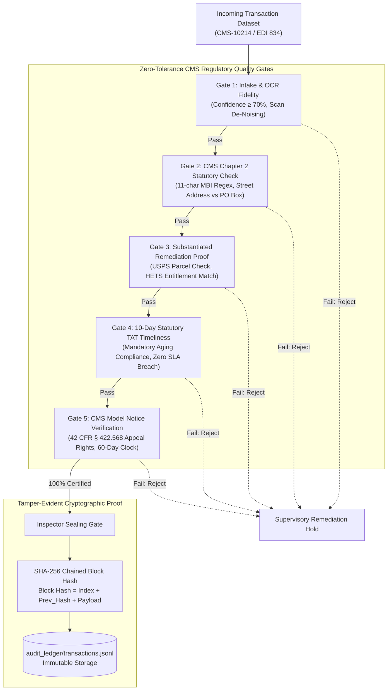

# Zero-Tolerance Quality Gates: Bringing CMS Medicare Audit Discipline to Autonomous AI Pipelines

*How 9 years auditing Medicare transactions shaped my approach to AI safety, data integrity, and tamper-evident SHA-256 ledgers.*

---

## 1. What "Zero-Tolerance" Really Means in Healthcare Operations

In enterprise technology, engineers often speak of "high availability" or "acceptable error budgets." In federal Medicare compliance at **Enterprise Healthcare Operations**, there is no such thing as an acceptable error budget.

Between 2016 and 2023 as an **Enrollment Quality & Audit Representative (CMS Auditor)**, my role was to enforce statutory compliance checks across high-volume Medicare Advantage (MA-PD, D-SNP, PDP) enrollments. When the Centers for Medicare & Medicaid Services (CMS) audits an organization:
- A single missing beneficiary signature violates CMS Chapter 2 §40.2.
- Enrolling a member with a P.O. Box as their primary residence violates CMS §20.1.
- Failing to resolve an exception within the statutory **10-day Turnaround Time (TAT)** creates an immediate compliance breach.
- Altering any member demographic without documented, third-party substantiation triggers an audit finding.

When I transitioned into autonomous AI pipelines and multi-agent systems, I realized that modern agentic swarms face the exact same reliability crisis: agents hallucinate parameters, silently skip edge cases, or produce un-auditable outputs.

Here is how I implemented zero-tolerance verification in **MediFlow**.

---

## 2. The 5 Mandatory Quality Gates

Every transaction executed by our autonomous multi-agent swarm must pass through five rigorous quality gates evaluated by an independent auditor agent (**Inspector**):



If any single quality gate fails, the transaction is rejected or flagged for immediate supervisory remediation. No transaction reaches CMS without passing all five gates.

---

## 3. The Mathematics of 10-Day TAT Aging

In our work basket exception queue, items are not processed randomly. The `Raj` exception worker uses a priority scoring formula:

$$\text{Priority Score} = \text{Age in Days} \times 10$$

Where:
- $\text{Age} \ge 9$: **CRITICAL (Days 9–10)**. Items approaching the 10-day statutory cliff are pulled immediately to prevent regulatory breach.
- $5 \le \text{Age} < 9$: **URGENT (Days 5–8)**. Secondary processing batch.
- $\text{Age} < 5$: **ROUTINE (Days 1–4)**. Standard FIFO intake queue.

This guarantees that an aging P.O. Box address scrub (Day 9) is always picked and resolved before a newly ingested demographic mismatch (Day 2).

---

## 4. The Cryptographic SHA-256 Audit Ledger

To prevent retrospective alteration of audit findings, the **Inspector** agent commits every turn, decision, and quality gate verdict into an immutable cryptographic ledger (`audit_ledger/transactions.jsonl`).

Each block includes:
- `index`: Monotonically increasing block index.
- `app_id` & `transaction_id`: Application & MARx transaction identifiers.
- `timestamp`: ISO-8601 UTC timestamp.
- `event_type`: `APP_ENROLLMENT_CERTIFIED` or `APP_REMEDIATED_RESUBMITTED`.
- `verdict`: `PASSED`, `FAILED`, or `REMEDIATION_REQUIRED`.
- `previous_hash`: SHA-256 hash of the preceding block (or genesis `0`*64).
- `block_hash`: SHA-256 digest of the entire record payload chained to `previous_hash`.

If an attacker or rogue process modifies a single byte in any historical block, the hash chain breaks instantly, triggering an automated integrity violation:

```python
# Real-time ledger verification in MediFlow
def verify_integrity(self) -> tuple[bool, str]:
    prev_hash = "0" * 64
    for block in self.blocks:
        expected = self._compute_hash(block.index, prev_hash, block.agent, block.payload)
        if block.block_hash != expected:
            return False, f"Tampering detected at Block #{block.index}!"
        prev_hash = block.block_hash
    return True, "100% Mathematically Certified"
```

---

## 5. Live Showcase & Production Verification

Experience the system live:
- **Live Vercel Application**: [mediflow.kprsnt.in](https://mediflow.kprsnt.in) — run the single-application live simulation and inspect the real-time SHA-256 cryptographic ledger explorer.
- **Source Code & Unit Tests**: [github.com/kprsnt2/MediFlow](https://github.com/kprsnt2/MediFlow) with 36 automated pytest tests (`uv run pytest -v`).
- **Architecture Deep-Dive**: [kprsnt.in/blog/medicare_multi_agent_enrollment_audit](https://kprsnt.in/blog/medicare_multi_agent_enrollment_audit)
