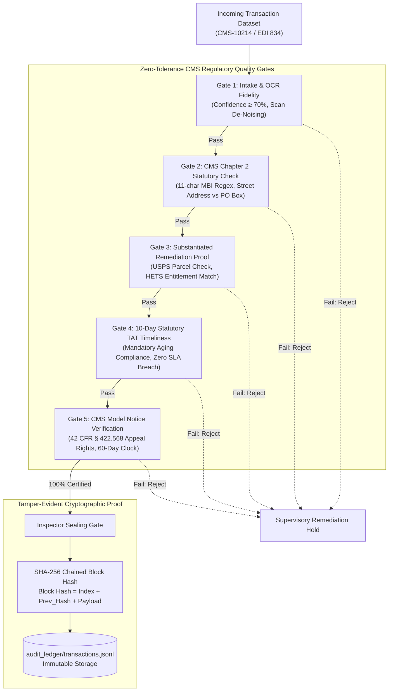

# Zero-Tolerance Quality Gates: Bringing CMS Medicare Audit Discipline to Autonomous AI Pipelines

*How 9 years auditing Medicare transactions shaped my approach to AI safety, data integrity, and tamper-evident SHA-256 ledgers.*

---

## 1. What "Zero-Tolerance" Really Means in Healthcare Operations

In enterprise technology, software engineers frequently speak of "high availability," "graceful degradation," or "acceptable error budgets." In federal Medicare compliance at **Enterprise Healthcare Operations**, there is no such thing as an acceptable error budget.

Between 2014 and 2016, I worked as a **Claims Associate** processing high-volume Medicare Advantage enrollment applications. I subsequently moved to the **Regulatory Adherence and Controls** team (2016–2023), auditing these applications against strict Centers for Medicare & Medicaid Services (CMS) regulations. 

When CMS conducts an audit, the standard is zero-tolerance:
- A single missing beneficiary signature violates CMS Chapter 2 §40.2.
- Enrolling a member with a P.O. Box as their primary residence violates CMS §20.1.
- Failing to resolve an exception within the statutory **10-day Turnaround Time (TAT)** creates an immediate compliance breach.
- Altering any member demographic without documented, third-party substantiation triggers an audit finding.

### The 2014 IT Stalemate vs Modern Multi-Agent Systems
During my frontline years in 2014–2016, we saw hundreds of recurring errors that could easily have been caught by proactive validation logic. But enterprise IT deemed modifying legacy application engines "not possible" due to monolithic architectural fragility and fear of regression.

Today, autonomous AI agents completely dismantle this barrier. **There is no need to modify brittle legacy code or wait for multi-year IT cycles.** By giving prompt instructions, regulatory guidelines, and standard operating procedures (SOPs) directly to autonomous agents, complex audits and exception remediations run in seconds.

During high-stress periods like the **Annual Election Period (AEP)**, this is game-changing. In particular, **Employer Group applications (EGWP)** regularly arrive in massive census batches with missing election forms and out-of-area mismatches, clogging work baskets almost instantly. When human specialists are overwhelmed, the 10-day statutory TAT standard gets breached. Autonomous agents prevent this by screening, sorting, and remediating applications at machine speed.

---

## 2. The 5 Mandatory Quality Gates

In **MediFlow**, every transaction executed by our autonomous multi-agent swarm must pass through five rigorous quality gates evaluated by an independent auditor agent (**Inspector**):



### Gate Breakdown
1. **Gate 1 (Intake & OCR Fidelity)**: Validates OCR confidence thresholds ($\ge 70\%$), ensures raw text captures required 11-character MBI syntax, checks for smudged signatures, and flags optical character confusion (e.g. `194B`, `0` $\leftrightarrow$ `O`, `5` $\leftrightarrow$ `S`).
2. **Gate 2 (CMS Chapter 2 Statutory Compliance)**: Strictly enforces MBI alphanumeric checksums, Section 20.1 physical street address requirements (P.O. Boxes prohibited), and Section 40.2 signature attestation.
3. **Gate 3 (Substantiated Remediation Proof)**: Requires documentary proof if an exception specialist altered data (USPS tax parcel verification, HETS MBD identity match, or state Medicaid dual check).
4. **Gate 4 (10-Day Statutory TAT Timeliness)**: Verifies that total operational age from application receipt to final adjudication did not exceed the 10-calendar-day CMS statutory limit.
5. **Gate 5 (CMS Model Notice Compliance)**: Confirms statutory model notices were generated with mandated clauses: Confirmation, Denial with Section 50.1 appeal rights, or 21-Day RFI with cure clock under 42 CFR § 422.568.

---

## 3. The Mathematics of 10-Day TAT Aging

In our work basket exception queue, items are not processed randomly. The `Raj` exception worker uses a priority scoring formula to guarantee statutory compliance:

$$\text{Priority Score} = \text{Age in Days} \times 10$$

Where:
- $\text{Age} \ge 9$: **CRITICAL (Days 9–10)**. Items approaching the 10-day statutory cliff are pulled immediately to prevent regulatory breach.
- $5 \le \text{Age} < 9$: **URGENT (Days 5–8)**. Secondary processing batch.
- $\text{Age} < 5$: **ROUTINE (Days 1–4)**. Standard FIFO intake queue.

This guarantees that an aging P.O. Box address scrub (Day 9) is always picked and resolved before a newly ingested demographic mismatch (Day 2). Under Employer Group (EGWP) volume surges, this mathematical discipline prevents SLA failures.

---

## 4. The Cryptographic SHA-256 Audit Ledger

To prevent retrospective alteration of audit findings, the **Inspector** agent commits every turn, decision, and quality gate verdict into an immutable cryptographic ledger (`audit_ledger/transactions.jsonl`).

Each block includes:
- `index`: Monotonically increasing block index.
- `app_id` & `transaction_id`: Application & MARx transaction identifiers.
- `timestamp`: ISO-8601 UTC timestamp.
- `event_type`: `APP_ENROLLMENT_CERTIFIED` or `APP_REMEDIATED_RESUBMITTED`.
- `verdict`: `PASSED`, `FAILED`, or `REMEDIATION_REQUIRED`.
- `previous_hash`: SHA-256 hash of the preceding block (or genesis `0`*64).
- `block_hash`: SHA-256 digest of the entire record payload chained to `previous_hash`.

```python
# Real-time ledger verification in MediFlow
def verify_integrity(self) -> tuple[bool, str]:
    prev_hash = "0" * 64
    for block in self.blocks:
        expected = self._compute_hash(block.index, prev_hash, block.agent, block.payload)
        if block.block_hash != expected:
            return False, f"Tampering detected at Block #{block.index}!"
        prev_hash = block.block_hash
    return True, "100% Mathematically Certified"
```

If an attacker or rogue process modifies a single byte in any historical block, the hash chain breaks instantly, triggering an automated integrity violation.

---

## 5. Model Development & Production Verification

MediFlow was engineered and tuned using a dedicated **DeepSeek harness** and Google Antigravity (**`agy` CLI**):
- **Frontier Model Evaluation**: Prompts and audit logic were refined across **`deepseek-4.1-flash`**, **`gemini-3.8-flash`**, and **`claude-opus-4.6`** models to ensure agents handle edge-case compliance without hallucination.
- **Runtime Flexibility**: Runs locally in terminal CLIs (`agy` / `omp`) or with API keys.
- **Online Vercel Showcase**: Deployed at [mediflow.kprsnt.in](https://mediflow.kprsnt.in) powered by Gemini with automatic OpenAI fallback.
- **Engineering Transparency**: While minor edge cases may exist in prototype display lifecycles, the multi-agent architecture and cryptographic audit ledger prove that autonomous agents can solve healthcare's toughest operational challenges.

Experience the live system:
- **Live Vercel Application**: [mediflow.kprsnt.in](https://mediflow.kprsnt.in)
- **Source Code & Unit Tests**: [github.com/kprsnt2/MediFlow](https://github.com/kprsnt2/MediFlow) (36 automated tests passing)
- **Architecture Deep-Dive**: [kprsnt.in/blog/medicare_multi_agent_enrollment_audit](https://kprsnt.in/blog/medicare_multi_agent_enrollment_audit)
